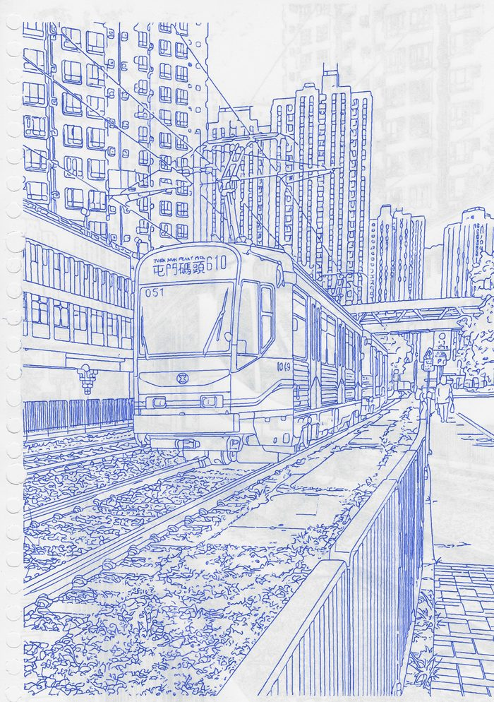
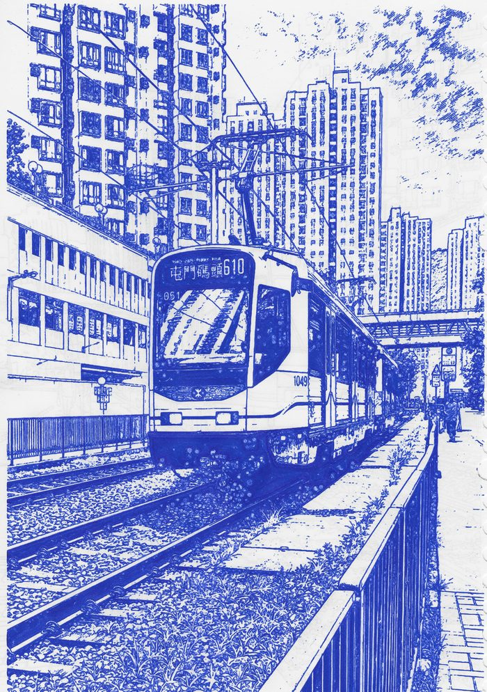
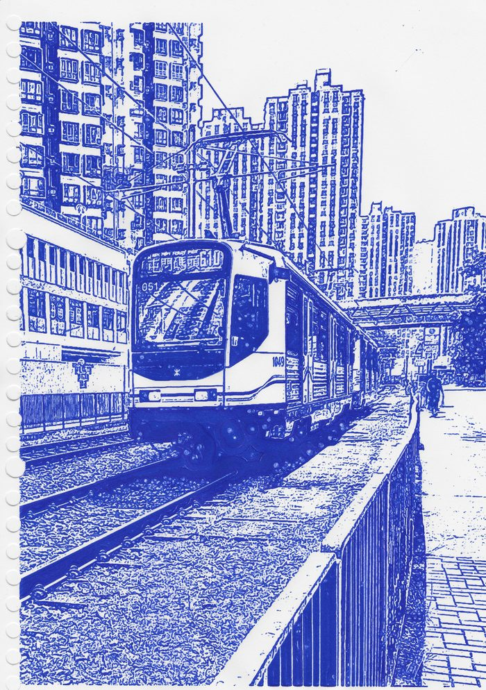
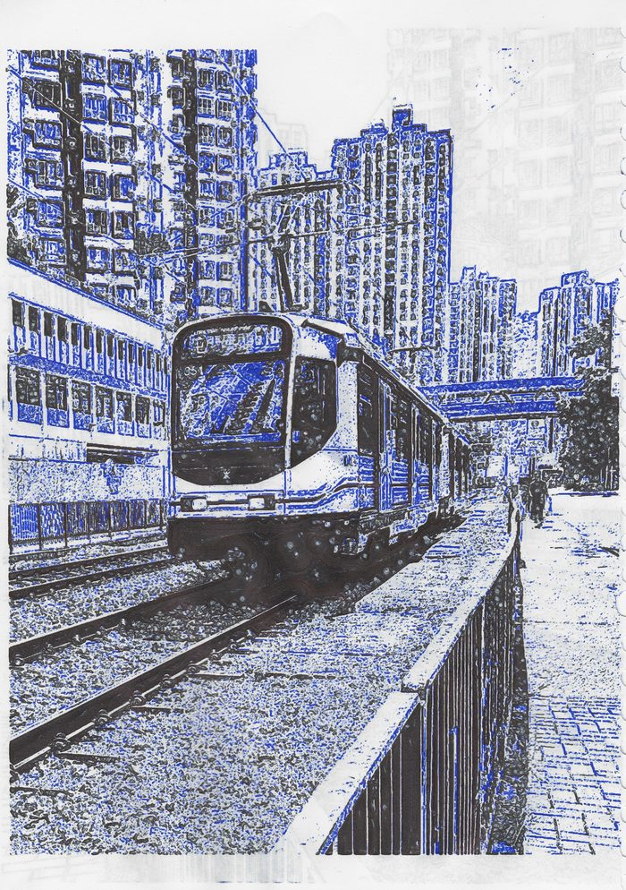

# ccPlotter

ccPlotter turns an image into G-code for a pen plotter. It is a Flask application
(OpenCV, scikit-image, [vpype](https://github.com/abey79/vpype)) that traces or
renders an image into pen strokes, optimises them, previews them on a sheet of paper,
and writes G-code for an Elegoo Centauri Carbon 3D printer that carries a pen
attachment. On Windows it ships as a desktop app (the same Flask app inside a native
window), and it can also be run from source in a browser.

## Quick start (Windows, no Python needed)

1. Download `ccPlotter-<version>-win64.zip` (for example `ccPlotter-84782f95-win64.zip`)
   from the **Releases** page of this repository (the asset attached to the latest release).
2. Unzip it anywhere (a folder you can write to; it is about 770 MB unpacked).
3. Run `ccPlotter\ccPlotter.exe`. A window opens; the app serves itself on a local
   port and listens on 127.0.0.1 only.

Your data (calibration, pen profiles, work files) lives in `%LOCALAPPDATA%\ccPlotter`,
not in the unzipped folder. Deleting the unzipped folder does not delete it.
The window uses Microsoft Edge WebView2, which is part of Windows 11 and most
Windows 10 installs.

### WARNING: the built-in pen heights are the author's, not yours

**Read this before you plot anything.** The pen Z heights, reach polygon and pen offsets
that come built in are the author's measurements for ONE printer, ONE pen holder and ONE
set of pens. They are not defaults that are safe for your machine, and **nothing in the app
will stop a wrong Z**: the app cannot know your machine, and it generates G-code from the seeded values with no abort and no prompt. A touch height that
is too high draws in the air; one that is too low drives the pen into the bed.

A fresh install seeds these `z_touch_abs` values (absolute machine Z, mm) into
`pen_profiles.json`:

| Profile | `z_touch_abs` | Notes |
|---|---|---|
| `energel_05` (**active by default**) | **12.05** | draws at Z 11.45 |
| `bic_cristal_black`, `bic_cristal_blue` | **18.75** | the calibration-sheet profile for the blue BIC uses 19.05 |
| `platinum_preppy` | **14.85** | also a Y offset of **-8.0 mm** (estimated, not measured) |

Because a pen profile's own `z_touch_abs` takes precedence, the "Z touch not calibrated"
error you might expect on a new install never fires with these profiles: the first G-code you
generate will use the author's 12.05.

The desktop app also seeds a `calibration.json` with the author's reach polygon
(`plotter_2003_v32`) and holder offset (-1.3, -43.7). Running from source seeds the pen
profiles but not `calibration.json`.

Before the first plot: measure your own touch height for each pen, edit the profile (see
[docs/CALIBRATION.md](docs/CALIBRATION.md)), delete the profiles you do not use, and do the
first run with the pen well above the paper and your hand on the stop button.

## What it does

You load an image, choose a rendering mode, preview the strokes on paper, and
generate a G-code file. The same photograph can be drawn quite differently depending
on the mode. The four scans below are physical plots of one Hong Kong tram photograph,
made on the author's machine.

| Physical plot (scan): Prepared line art | Physical plot (scan): Trace V3 |
|---|---|
|  |  |

| Physical plot (scan): Ink Sketch | Physical plot (scan): Black and blue, two pens |
|---|---|
|  |  |

The exact settings of these plots were not recovered; see
[examples/physical-tram/](examples/physical-tram/README.md). A reproducible run
generated in software only is in
[examples/synthetic-trace/](examples/synthetic-trace/README.md).

Modes in the UI: B/W photo (the default), Plot-Ready Line Art, Trace (V3), Trace V3+,
Black Line + Blue Tone (two pens, two G-code files), TSP Scribble (experimental) and
Sketch Field. Each mode and the stages after it are described in
[docs/PIPELINE.md](docs/PIPELINE.md).

## Hardware

An Elegoo Centauri Carbon (Klipper-based firmware) with a pen attachment beside the
retained hotend, so the machine stays a usable 3D printer. The G-code is written for
this one printer and firmware; see [docs/LIMITATIONS.md](docs/LIMITATIONS.md).

Output path: generate the G-code in the app, save it, and copy it to the printer on a
USB stick. The file does not home the printer; its header asks you to home it with the
pen removed (from the touchscreen) and then attach the pen. Never send bare M-code
files to the printer.

Optional and untested against hardware here: set the environment variable
`CCPLOTTER_PRINTER_HOST` to the printer's address to enable the network routes (send
file, live status, live Z). Unset, nothing connects and those routes return a 503.

## Run from source (secondary path)

Windows with Python 3.11. `requirements-lock.txt` pins the tested set; install it with
`--no-deps` (the set keeps numpy 1.26.4 with OpenCV 4.13, which pip will not resolve
on its own). `requirements.txt` lists only the top-level packages. macOS and Linux were not
tested.

```powershell
python -m venv .venv
.\.venv\Scripts\Activate.ps1
pip install --no-deps -r requirements-lock.txt

$h = "C:\ccplotter-home"        # your choice: absolute, ASCII-only, outside this repository
python scripts/launch.py --home $h --port 5001
```

Then open `http://127.0.0.1:5001/` in a browser. The launcher keeps all state in
`<home>` and never writes into the source tree. Unlike the desktop app it does not
seed `calibration.json`, but the pen profiles are still seeded with the author's values;
see the warning above.

To build the desktop app yourself: `powershell -File desktop\build.ps1` (PyInstaller;
output in `dist\ccPlotter`).

## What changed since the first public snapshot (2026-10-26)

- "Stay down over ink" is on by default: the pen stays down across short gaps that are
  inside inked areas instead of lifting.
- B/W photo is the default processing style, and its structure-aware binary stage is on
  by default (a checkbox turns it off).
- Row-filled areas now run at a "/" angle by default; the row direction is selectable.
- Opt-in "ink-routed connectors": hops become pen-down connectors inside the layer's
  ink region.
- New calibration sheets for row direction and ink-routed connectors.
- G-code comments in the fan-probe sheet are ASCII-only (the firmware parser rejects
  other characters).

## Optional integrations

None is needed for the core workflow; each fails with a clear message when absent.

| Integration | How to enable | When unavailable |
|---|---|---|
| OpenAI image API (AI line-art cleanup) | environment variable `OPENAI_API_KEY` | the route returns 503 |
| Local ComfyUI | a server at `http://127.0.0.1:8188` (see `ai_config.json`) | the AI routes return 503 |
| Inkscape | on `PATH` or the default install folder | only some non-default render paths |
| DrawingBotV3 | environment variable `CCPLOTTER_DBV3_EXE` | the launch route returns 404 |
| Flow mode (`vpype-flow-imager`) | `pip install -r requirements-optional.txt` | known broken with numpy 2.x; untested with the numpy 1.26 lock |

The OpenAI and ComfyUI integrations send your image to those services.

## Tests

See [docs/TESTING.md](docs/TESTING.md). `python scripts/run_tests.py` runs every test
file in its own process; `scripts/replay_harness.py verify` replays recorded requests
against pinned G-code hashes.

## Known limitations

See [docs/LIMITATIONS.md](docs/LIMITATIONS.md).

## Licence and third-party material

Copyright (C) 2026 Kai Keller. ccPlotter is licensed under the GNU Affero General
Public License v3.0; see [LICENSE](LICENSE). Attributions and dependency licences,
including the CC BY 2.0 test photographs, are in
[THIRD_PARTY_NOTICES.md](THIRD_PARTY_NOTICES.md).
