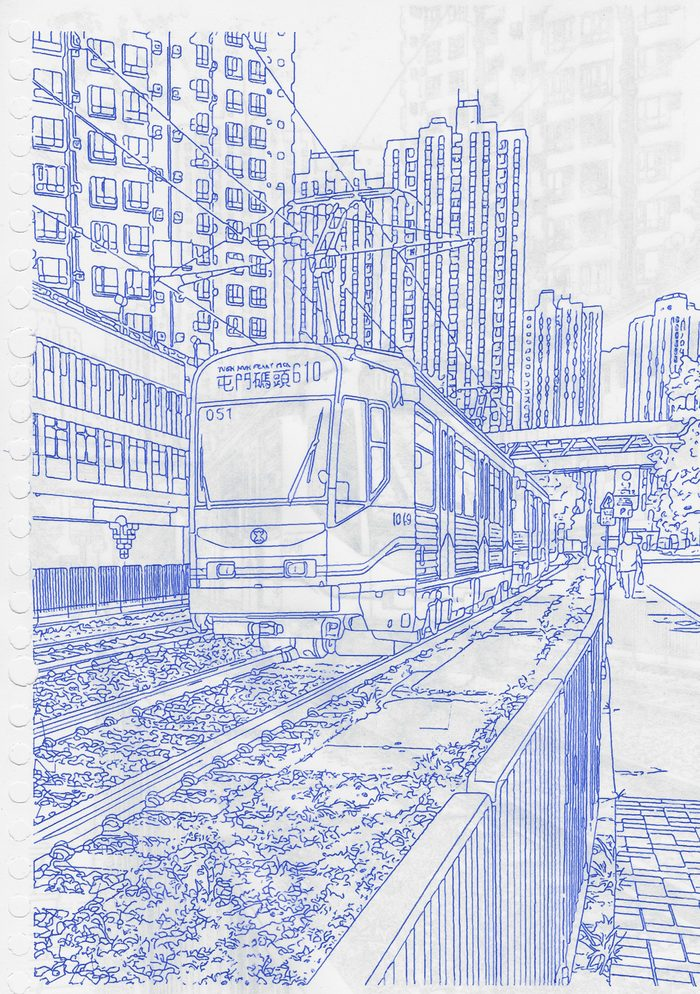
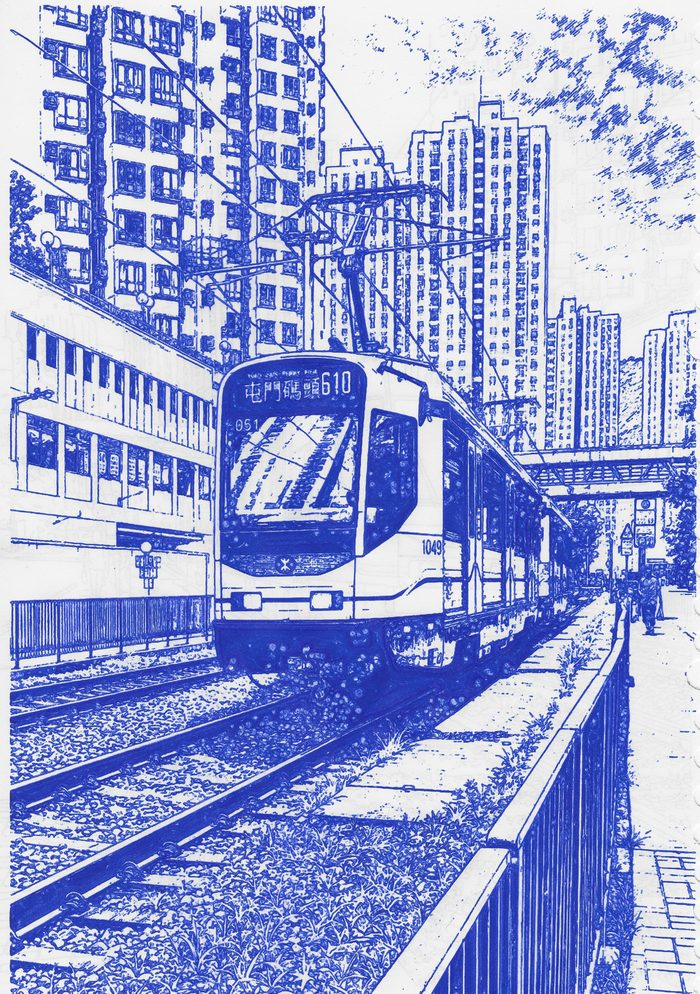
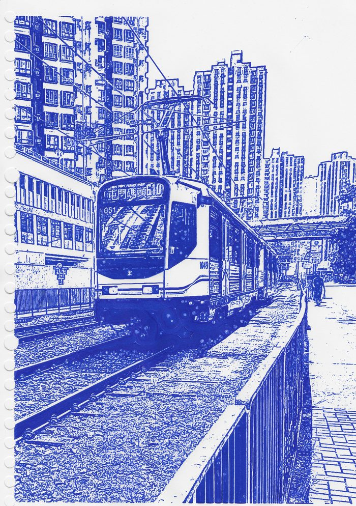
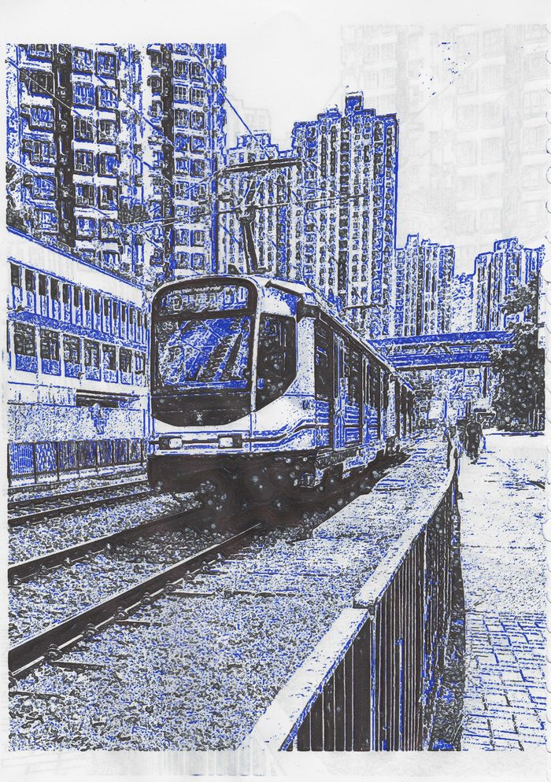

# ccPlotter

ccPlotter converts an image into G-code for a pen plotter. It is a local web
application (Flask, with a browser UI) that uses OpenCV, scikit-image and
[vpype](https://github.com/abey79/vpype) to turn an image into pen strokes,
optimise them, and write G-code for an Elegoo Centauri Carbon 3D printer that
carries a pen attachment.

## What it does

You load an image, choose a rendering mode, preview the strokes on a sheet of
paper, and generate a G-code file. The same photograph can be drawn in quite
different ways depending on the mode. The four scans below are physical plots of
one Hong Kong tram photograph, made on the author's machine; the modes are named
as captioned on the project's website.

| Physical plot (scan): Prepared line art | Physical plot (scan): Trace V3 |
|---|---|
|  |  |

| Physical plot (scan): Ink Sketch | Physical plot (scan): Black and blue, two pens |
|---|---|
|  |  |

The exact settings of these plots were not recovered for this release; see
[examples/physical-tram/](examples/physical-tram/README.md), which also has the
source photograph (the author's own) and larger copies. A reproducible run that
was generated in software only is in
[examples/synthetic-trace/](examples/synthetic-trace/README.md).

## Hardware

The pen attachment sits alongside the printer's retained hotend, so the machine
remains a usable 3D printer. The printer is an Elegoo Centauri Carbon (Klipper-based
firmware). The generated G-code is written for this one printer and its
firmware; see [docs/LIMITATIONS.md](docs/LIMITATIONS.md).

## Supported setup

- Windows with Python 3.12 (python.org 3.12.0), using the exact package set
  pinned in `requirements-lock.txt`.
- macOS and Linux were not tested.

## Pipeline in short

source image, then a rendering mode, then strokes, then vpype optimisation,
then G-code through the `elegoo_cc` profile in `vpype.toml`, then a preview.

The mode selector in the UI offers: Plot-Ready Line Art, Trace (V3) (the
default), Trace V3+, B/W photo, Black Line + Blue Tone (2 pens, two G-code
files), TSP Scribble (experimental) and Sketch Field. Each mode, and the stages
after it, is described in [docs/PIPELINE.md](docs/PIPELINE.md).

## Install and launch

These commands were run successfully for this release (Windows, Python 3.12.0):

```powershell
python -m venv .venv
.\.venv\Scripts\Activate.ps1
pip install -r requirements-lock.txt     # the tested set; requirements.txt lists only the top-level packages
```

Start the server with a runtime home that is an absolute path outside the source
tree. The launcher creates it and keeps all state (calibration, pen profiles,
work files) there, never in the repository:

```powershell
$h = "C:\ccplotter-home"                  # your choice; must be absolute, ASCII-only and outside this repository
python scripts/launch.py --home $h --port 5001
```

Then open `http://127.0.0.1:5001/`. The server listens on 127.0.0.1 only. The
launcher keeps the work files in `<home>\work` (it sets `CCPLOTTER_WORK_DIR` to
that absolute path itself). The UI itself was not exercised in a browser for this
release; the HTTP API was, including every `/work/` asset the UI loads for a
preview and the G-code download. See [docs/LIMITATIONS.md](docs/LIMITATIONS.md).

Do not run the first plot with the shipped Z heights: read
[docs/CALIBRATION.md](docs/CALIBRATION.md) first.

## Reproduce the example

[examples/synthetic-trace/](examples/synthetic-trace/README.md) contains a
synthetic input image, the exact request settings, the preview, the G-code and its
sha256, and a script that reproduces them against a running server. It was
generated in software and not physically plotted.

## Output and printer connection

Supported path: generate the G-code in the UI, save it as a file, and copy it to
the printer on a USB stick. This is the author's normal workflow. The generated
file does not home the printer: its header asks you to home the printer with
the pen removed (from the printer's touchscreen) and then attach the pen.

Optional, untested here: if the environment variable `CCPLOTTER_PRINTER_HOST` is
set to the printer's address, the app opens a network connection to it and the
network routes (send file, live status and live Z read) become active. With the
variable unset, nothing connects and those routes return a 503 "No printer host
configured". This release did not test the network path against hardware.

## Optional integrations

None of these is needed for the core example. Each fails with a clear message
when it is unavailable.

| Integration | How to enable | When unavailable |
|---|---|---|
| OpenAI image API (AI line-art cleanup) | environment variable `OPENAI_API_KEY` | the start route returns a 503 saying no key was found |
| Local ComfyUI | a ComfyUI server (default `http://127.0.0.1:8188`, configurable in `ai_config.json`) | the AI routes return a 503 saying ComfyUI is not running |
| Inkscape | Inkscape on `PATH` or in its default install folder | only used by some non-default render paths; raises "Inkscape not found" |
| DrawingBotV3 | environment variable `CCPLOTTER_DBV3_EXE` set to `DrawingBotV3-Premium.exe` | the launch route returns a 404 |
| Flow mode (`vpype-flow-imager`) | `pip install -r requirements-optional.txt` | **currently broken**: with numpy 2.4 (the pinned version) `flow_img` fails with a `TypeError` inside `vpype_flow_imager`. It is not reachable from the mode selector, only through the API |

The OpenAI and ComfyUI integrations send your image to those services (the first
is a cloud API); they were not exercised in this release.

## Calibration requirements

The Z heights, reach polygons, pen offsets and pen profiles that ship with the
code are the author's measurements for one machine. Re-measure them on your own
before plotting. See [docs/CALIBRATION.md](docs/CALIBRATION.md).

## Known limitations

See [docs/LIMITATIONS.md](docs/LIMITATIONS.md).

## Tests

See [docs/TESTING.md](docs/TESTING.md). In short:
`python scripts/run_tests.py` runs every test file in its own process, and
`scripts/replay_harness.py verify` replays recorded requests against pinned
G-code hashes.

## Desktop app

A Windows packaging spec (PyInstaller) is included under `desktop/`. No packaged
build was verified for this release, and running `python desktop/ccplotter_app.py`
from source was not verified either. Neither is claimed to work.

## Third-party material and licence

Attributions and dependency licences are in
[THIRD_PARTY_NOTICES.md](THIRD_PARTY_NOTICES.md).

Copyright (C) 2026 Kai Keller. ccPlotter is licensed under the GNU Affero General
Public License v3.0; see [LICENSE](LICENSE). Third-party images keep their own
licences, listed in the notices file.
